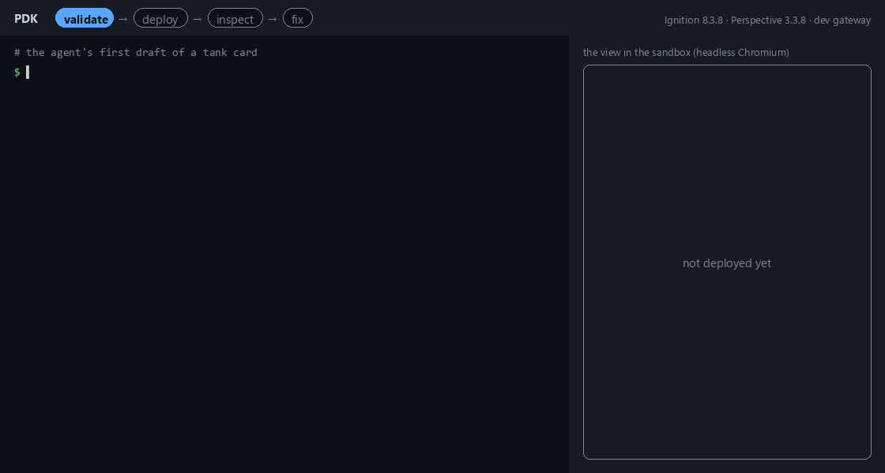

# PDK for Ignition Perspective

[](https://github.com/fcastel2002/pdk/actions/workflows/ci.yml)
[](LICENSE)

## Status: final community edition

PDK 0.5.0 is the last release of this repository, which is now frozen and archived. It remains available under the Apache License 2.0, as every earlier release does: you can use, fork and modify it under those terms. It will not receive further changes, fixes (security fixes included) or support.

Development continues as a commercial edition, maintained for newer Ignition and Perspective versions, with a signed gateway module and support. If you are interested, contact me through GitHub: [@fcastel2002](https://github.com/fcastel2002).

Thank you to everyone who tried PDK and shared feedback.

## About PDK

PDK (Perspective DevKit) is a set of tools for an AI agent (Claude Code or any MCP client) to build and fix Ignition Perspective views (`view.json`) — and to prove they work before you open them. PDK closes the loop *generate → validate → deploy → inspect → fix*:

- **Validate** views against the exact schemas of the Perspective version you have installed: props, bindings, events, expressions and scripts, with a JSON pointer and a hint on every diagnostic.
- **Deploy** them to a sandbox project on your development gateway without ever overwriting a Designer edit (signed writes, 409 with a diff on conflict).
- **Inspect** them running: PDK opens the view in headless Chromium and joins the DOM with the gateway's evaluated tree, so clipped text, collapsed containers, bad tag qualities, failing scripts and browser errors come back on the component that has them. Layout and behavior requests are checked, not eyeballed: `--expect "root/Body below root/Header; root/Header width 100%"`, `--act "click root/Save"`.



> **Development gateways only.** PDK installs an unsigned module that writes to a sandbox project. Never install it on a production gateway.

PDK is an independent project. It is not affiliated with, endorsed by or supported by Inductive Automation. Ignition and Perspective are trademarks of Inductive Automation.

## Requirements
- **Ignition 8.3 installed on the same machine**, with Perspective. The PDK module only answers loopback connections. Tested with Ignition 8.3.8–8.3.9 (Perspective 3.3.8–3.3.9).
- **[uv](https://docs.astral.sh/uv/)** (the installer gets it, and uv gets Python 3.12+). No Python, git or clone needed.
- **JDK 17 or newer**, to build the gateway module. PDK looks in `JAVA_HOME`, the `PATH` and the usual install folders.
- **Optional: [Claude Code](https://claude.com/claude-code)**, which picks up the MCP server (`.mcp.json`), the validation hook and the `perspective-views` skill that `pdk init` writes in your folder. Any other MCP client works with `pdk-mcp`.

## Install
Windows (PowerShell):
```powershell
irm https://raw.githubusercontent.com/fcastel2002/pdk/main/install.ps1 | iex
```
Linux and macOS:
```bash
curl -LsSf https://raw.githubusercontent.com/fcastel2002/pdk/main/install.sh | sh
```
The installer installs uv if it is missing and PDK as a command (`uv tool install pdk-perspective`): `pdk` and `pdk-mcp` then work from any folder. It sets up `./pdk-views` for Claude Code with `pdk init` (set `PDK_PROJECT` to change it), extracts the schemas of your Perspective into `~/.pdk/schemas/` and downloads Playwright's Chromium. Then it runs `pdk doctor`, which lists what is left on the gateway side. It never touches the gateway or anything that needs admin rights, and it is safe to run again to update.

By hand, the same thing is:
```bash
uv tool install pdk-perspective
pdk init my-views        # any folder: skill, subagents, MCP server, hook and CLAUDE.md for Claude Code
pdk doctor --fix
```
PDK says when a newer release is out (one check a day against GitHub, also told to the agent at the start of a session); update with `uv tool upgrade pdk-perspective`. To work on PDK itself, clone the repo and run `uv sync` (see [CONTRIBUTING.md](CONTRIBUTING.md)); in a clone the commands are `uv run pdk ...`.

## Gateway setup
`pdk doctor` checks every step and says what is missing. Run it at the start and at the end.

1. **Create the sandbox project.** It is the only project PDK writes to: create an empty Perspective project (for example `pdk_sandbox`) from the gateway web page or the Designer. Do not use a real project.

2. **Edit `ignition.conf`** (needs admin). In `<Ignition>/data/ignition.conf` add two `wrapper.java.additional.N` lines, with free values of N; `pdk doctor` tells you which:
   ```
   wrapper.java.additional.10=-Dignition.allowunsignedmodules=true
   wrapper.java.additional.11=-Dpdk.sandbox=pdk_sandbox
   ```
   Restart the gateway. Without `-Dpdk.sandbox` the module is read-only.

   Optional: a **target project** for finished screens (for example a copy of your production project imported into this development gateway):
   ```
   wrapper.java.additional.12=-Dpdk.target=<final_project>
   ```
   The target only receives finished work (views, style classes and project scripts outside `PDK/`, and the stylesheet), and only through `pdk promote <sandbox view> --to-project target [--to <path>]`: no direct deploy and no page config, except the eyes' preview pages under `/pdk/` to look at a promoted view. A promote is refused if the view references views under `PDK/`, and warns about references the target does not have. It must differ from the sandbox.

3. **Create an API key** on the gateway web page (*Platform > Security > API Keys*), with security level *Administrator* and *Require secure connections* unchecked. Save it to `~/.pdk/ignition-api-key`, or as `api_key` in the config file (below). It is only used to install the module and restart the gateway.

4. **Install the module:**
   ```bash
   pdk gateway install --restart
   ```
   It compiles the module's Java sources (shipped with PDK) against the jars of your install, uploads it through the REST API, accepts its certificate (it is an unsigned module) and restarts the gateway.

5. **Check:**
   ```bash
   pdk doctor
   ```
   Every check should be `ok`. Optionally, from a clone, `uv run pytest -m gateway` runs the live tests, which write only under `PDK/_selftest/` in the sandbox and delete what they create.

## Configuration
Everything is configured through environment variables. To avoid setting them in every shell, in the MCP server and in the hook, put them in `~/.pdk/config.toml` (or another file pointed to by `PDK_CONFIG`). A variable that is already set wins over the file.

| Key in `config.toml` | Variable | Default |
|---|---|---|
| `gateway_url` | `PDK_GATEWAY_URL` | `http://127.0.0.1:8088` |
| `ignition_home` | `IGNITION_HOME` | the standard path of each OS |
| `api_key` | `PDK_IGNITION_API_KEY` | `~/.pdk/ignition-api-key` |
| `work_dir` | `PDK_WORK_DIR` | `work/` in the current folder (in a clone, in the repo) |
| `schemas_dir` | `PDK_SCHEMAS_DIR` | `~/.pdk/schemas/` (in a clone, `schemas/` in the repo) |
| `perspective_version` | `PDK_PERSPECTIVE_VERSION` | the newest bundle |
| `update_check` | `PDK_UPDATE_CHECK` | on; `false` (or `0`) stops the daily check for a newer release |

```toml
gateway_url = "http://127.0.0.1:8088"
ignition_home = "C:/Program Files/Inductive Automation/Ignition"
```

The sandbox name is not configured in PDK: `-Dpdk.sandbox` sets it on the gateway and the client reads it from `/health`.

## Usage
**With Claude Code**, open the folder you set up with `pdk init` (`claude` in it), approve the `pdk` MCP server and ask for a screen. The `perspective-views` skill drives the cycle:

catalog → write `view.json` → validate → deploy → inspect → fix.

**From the CLI**, the same steps:
```bash
uv run pdk catalog ia.display.table --prop columns
uv run pdk validate work/<sandbox>/PDK/Pump/view.json
uv run pdk deploy work/<sandbox>/PDK/Pump
uv run pdk inspect PDK/Pump
uv run pdk inspect PDK/Pump --query root/Header
uv run pdk inspect PDK/Pump --expect "root/Body below root/Header; root/Header width 100%"
uv run pdk tags apply sample
uv run pdk inspect PDK/Pump --act "tag Sandbox/Setpoint 42" --expect "root/Value text \"42\""
uv run pdk screenshot PDK/Pump --out pump.png
```
The project stylesheet is edited in the sandbox too: `uv run pdk pull stylesheet` downloads `work/<sandbox>/_stylesheet/stylesheet.css` and `uv run pdk deploy work/<sandbox>/_stylesheet` uploads it.

**From another MCP client** (Codex, Gemini CLI, VS Code, Cursor…), register the stdio server with the `work/` of the folder you set up with `pdk init`, where the pulled views go:
```json
{"mcpServers": {"pdk": {"command": "pdk-mcp", "env": {"PDK_WORK_DIR": "/path/to/screens/work"}}}}
```
From a clone: `"command": "uv", "args": ["--directory", "/path/to/pdk", "run", "--quiet", "pdk-mcp"]`. Per-client formats are in the [agents guide](https://fcastel2002.github.io/pdk/guide/agents.html).

The full documentation, with a step-by-step tutorial and the reference of every command and diagnostic, is at **https://fcastel2002.github.io/pdk/**.

### Diagnostics
Codes are stable; each diagnostic reads `E|W|I CODE /json/pointer (component path) | message | hint`.

| Family | From | Examples |
|---|---|---|
| `S`, `P`, `B`, `E`, `R`, `HMI` | `pdk validate` (offline) | unknown prop with "did you mean", wrong binding type, expression syntax, unindented script, missing embedded view, unsized table |
| `G` | the gateway | G008 someone changed the view since your pull, G013 write outside `PDK/` |
| `V`, `Q`, `L`, `C`, `X` | `pdk inspect` | V001 clipped text, V007 collapsed, Q001 `Bad_NotFound`, L001 script failed on the gateway, C001 browser error |
| `A` | `--expect` / `--act` | A001 expectation not met (with the measured values), A004 step could not be done |

## Safety
- The module only answers loopback connections and requires a token that changes on every start.
- It writes only to the sandbox, and only if the gateway started with `-Dpdk.sandbox`. Tags: only under `[default]PDK/` (UDT definitions under `[default]_types_/PDK/`), memory tags only.
- Every write carries the expected signature, so a Designer edit is never overwritten (409 with a diff).
- **Do not install it on a production gateway.** See [SECURITY.md](SECURITY.md).

## Not sure you can trust it?
You are about to run an installer, install an unsigned module on your gateway and give an agent write access to a project, so being cautious is reasonable. If you will not read the code yourself, ask an AI model you trust (Claude, ChatGPT or another) to review it for you before installing. Point it at the repository (`https://github.com/fcastel2002/pdk`), or better, clone it and open it in a coding agent so it reads the actual files, and ask something like:

> Review this repository as a security auditor before I install it on my machine and my Ignition gateway. Tell me whether it contains malware, hidden network calls or telemetry, data exfiltration, obfuscated code, or anything that writes outside what the README says. Check in particular `install.ps1` and `install.sh`, the Java module in `gateway/` (what its REST API allows and from where), and the Python package in `pdk/` (which hosts it contacts, which files and gateway resources it writes). Point to the exact files and lines behind each finding.

What a review should find, so you can compare:
- The installers download only [uv](https://docs.astral.sh/uv/) from astral.sh, PDK and its Python packages from PyPI (from GitHub if PDK is not on PyPI yet) and Playwright's Chromium.
- PDK itself contacts your gateway URL (`http://127.0.0.1:8088` by default) and, once a day, GitHub's public API for the latest release number (`pdk/update.py`; nothing about your machine is sent, `PDK_UPDATE_CHECK=0` turns it off). There is no telemetry.
- The module answers loopback only, needs a per-start token, and writes only to the sandbox project, the optional target project and tags under `[default]PDK/`.

An AI review lowers the risk, it does not remove it: models can miss things. For a production network, have someone you trust read the code, and keep PDK on a development machine as recommended above.

## Repository layout
| Path | What it is |
|---|---|
| `pdk/` | The Python package: validator (`validate/`), eyes (`eyes/`), catalog, sync, MCP server, hook, gateway client |
| `gateway/` | The thin Java 17 gateway module (REST API for resources, sessions, logs and tags) |
| `.claude/` | Claude Code integration: the `perspective-views` skill with snippets, Haiku subagents, the validation hook |
| `tests/` | pytest suite; `tests/fixtures/compiler-v1/` are views saved by the Designer (Perspective 3.3.8) |
| `bench/` | Benchmark briefs, simulated tags and the validator's mutation score |
| `docs/` | The documentation (Sphinx), published at https://fcastel2002.github.io/pdk/ |

## Contributing
This repository is archived and no longer takes issues or pull requests. You are welcome to fork it under the Apache License 2.0.

## Support and services
The community edition is not supported. The maintained commercial edition, support, and services (screens built with PDK, Vision → Perspective migrations, assisted setup and training) are available from [Francisco Castel](https://github.com/fcastel2002): reach out through GitHub.

## License
[Apache License 2.0](LICENSE). See [NOTICE](NOTICE) for attributions.
